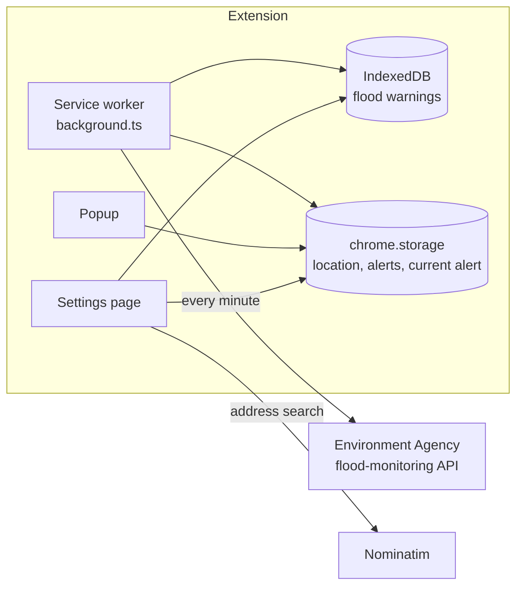

# FloodWatch


FloodWatch is a Chrome extension which warns people in England when a flood warning covers a place they care about. A friend and I built it with React 18, TypeScript, Vite and Tailwind CSS. It reads the Environment Agency's live flood warnings, draws them on a map and sends a notification when a warning reaches the saved location.

**Live demo:** [erikm9.github.io/floodWatch](https://erikm9.github.io/floodWatch/), which runs the extension in the page on the Environment Agency's live data and offers the latest build to download.

## Features

- A map of the flood warnings in England, each area in the colour of its severity, with the more severe areas drawn on top where they overlap
- An address search for places in England, through OpenStreetMap's Nominatim, which marks the location on the map
- A flood report for the saved location: the county, the severity, the river or sea, the Environment Agency's message and when it last changed
- Notifications when a warning reaches the saved location or the risk there rises, which the popup turns on and off
- A check every minute in the background, which downloads the outline of each flood area once and keeps it while the area has a warning

## How it works



The service worker in `src/chrome-extension/background.ts` does the checking. An alarm wakes it every minute, and it also runs when Chrome starts and when the extension is installed. It downloads the current warnings from the Environment Agency's flood-monitoring API (`api/ukFlood.ts`), along with the outline of any flood area it doesn't have yet, and keeps them in IndexedDB (`services/floodDatabase.ts`). When a download fails it keeps what it has, so a dropped connection doesn't look like the end of a flood. Chrome stops a service worker which has gone 30 seconds without an event or a call to a Chrome API, so during a long download it calls one every 25 seconds to stay awake until it's done.

It then checks the saved location against the outlines with Turf.js (`services/FloodDataService.ts`). Where areas overlap, the most severe warning wins. The outcome goes into `chrome.storage`, where the popup and the settings page pick it up. When alerts are on, a notification goes out when a warning reaches the location or its risk rises, and when a new location is saved or the alerts are turned on while a warning is in force there. Warnings the Environment Agency marks as no longer in force still show in the report, but they don't notify. A newly saved location is checked straight away against the warnings already downloaded, and the checks run one at a time, so an earlier one can't overwrite the outcome of a later one.

The settings page (`options/index.tsx`) finds addresses through Nominatim (`api/geocoding.ts`) and only accepts places in England, since the Environment Agency only issues warnings for England. It draws the warnings with React Leaflet over OpenStreetMap tiles.

## Running it locally

You need Node.js 22.13 or newer (CI uses Node 22) and Chrome or another Chromium browser.

```bash
npm install
npm run build
```

Then open `chrome://extensions`, turn on Developer mode, choose Load unpacked and pick the `dist` folder. Open the extension's settings page, search for an address in England and turn the alerts on in the popup.

`npm run dev` makes a development build, which keeps the console logging, and rebuilds whenever a file changes. Reopen the popup or the settings page to see a change there, and reload the extension on `chrome://extensions` after a change to the service worker.

## The website

`website/` holds the demo site, which CI deploys to GitHub Pages from `main`. It explains what the extension does, offers the latest build as a zip and runs the extension itself in the page.

The demo runs the extension's own code rather than a copy of it. The page loads the real service worker (`background.ts`), and two frames load the real popup and settings page. A web page doesn't have Chrome's extension APIs, so `website/src/demo/runtime.ts` stands in for the ones the extension uses: storage, which keeps values as JSON and only reports the keys whose value changed, the alarm, notifications, which show in the page, and the install event, which runs the first check as the page opens. Each window builds its own `chrome` object around that one stand-in (`chromeApi.ts`), so the page and both frames share the same storage, and as they share an origin, they share the IndexedDB database the warnings are kept in as well. The page also watches the extension's requests to the Environment Agency (`downloads.ts`) to show how the first download is going and whether the latest one worked. It offers up to three places with a warning in force, each at a point inside its area where the extension finds that warning rather than one overlapping it, so the popup shows the warning the button names (`places.ts`). The settings page's map only reads the warnings as it opens, so the page loads it again when a download changes the areas on the map.

The download is the extension's `dist` folder, which a small Vite plugin in `website/vite.config.ts` zips into the site with fflate. `npm run build:site` builds the extension first, so the download matches the code the site was built from.

```bash
npm run build:site                                  # the extension, then the site, into site/
npx vite preview --config website/vite.config.ts    # serves site/ on http://localhost:4173
```

`npm run dev:site` serves the site with hot reloading, but without the download, which only exists in a build. GitHub Pages has to be set to deploy from GitHub Actions once, in the repository settings.

## Scripts

| Command | What it does |
|---|---|
| `npm run build` | Production build into `dist`, with the console logging stripped |
| `npm run dev` | Development build, rebuilt on every change |
| `npm run build:site` | Production build of the extension, then of the website into `site`, with the extension zipped into it |
| `npm run dev:site` | The website on a development server, without the download |
| `npm run lint` / `npm run lint:fix` | ESLint over the code, the tests and the configs, and the same with fixes applied |
| `npm run typecheck` | The TypeScript check of the extension, the website, the tests and the configs |
| `npm test` / `npm run test:coverage` | Unit and component tests, the second one with coverage |
| `npm run test:watch` | The same tests in watch mode |
| `npx playwright install chromium` | Downloads the browser the Playwright specs run in, once before the first run |
| `npm run test:e2e` | Builds the extension and the website and runs every Playwright spec against them |

## Permissions

| Permission | What it's for |
|---|---|
| `storage` | Keeps the saved location, the alerts setting and the alert for the location |
| `alarms` | Wakes the service worker for the check every minute |
| `notifications` | Sends the flood alerts |
| `https://environment.data.gov.uk/*` | Downloads the flood warnings and the outlines of the flood areas |

## Testing

| Level | Tool | Tests |
|---|---|---|
| Unit | Vitest | 92 |
| Component | Vitest and Testing Library, in jsdom | 26 |
| End-to-end | Playwright, on the production builds | 30 |

### Why these tools?

In my smaller projects I picked the testing tools so I could learn how various testing tools work. For FloodWatch I went with Vitest, Testing Library, user-event, MSW, fake-indexeddb, Playwright and axe-core, because they fit the project best and were the practical choice.

- Vitest runs on the same Vite config as the build, so the tests get the `@` path alias and the asset imports without any extra setup. It runs the components in jsdom and has a watch mode and coverage of its own.
- Testing Library and user-event find elements by their role, label and text and use them the way a person would, so the component tests check what the user sees and does instead of the components' internals.
- MSW answers the requests to the Environment Agency and Nominatim at the network level, so the code under test makes its real `fetch` calls and gets real HTTP responses, error codes included.
- fake-indexeddb gives the tests a working IndexedDB, so the warnings are stored and read the way the service worker does it in Chrome.
- Playwright loads the built extension into Chromium and runs its real service worker, and `context.route` lets the test process answer every request the extension makes.
- axe-core runs the WCAG 2.1 A and AA scans through `@axe-core/playwright`.

### Unit and component tests

The unit tests cover the service worker, the flood matching and the two API modules, and the website's demo: its stand-in for Chrome, the watch on the downloads, the places it offers, the status line and the store behind it. `tests/support/chrome.ts` is an in-memory version of the Chrome APIs the extension uses: storage which keeps values as JSON and only reports the keys whose value changed, alarms, notifications which insist on their required fields, and the install and start-up events. It keeps track of the work each listener starts, so a test can wait until the extension has finished reacting instead of sleeping. It also records when the extension last called a Chrome API or received an event, which is what Chrome goes by when it stops a quiet service worker, so a test can check that a long download keeps the worker awake.

The Environment Agency and Nominatim are answered by MSW handlers (`tests/support/server.ts`) built from the same fixtures as the end-to-end specs. `tests/support/floodData.ts` builds warnings, flood areas and outlines shaped like the API's own, among them an area in two parts and one with a hole in it, and `tests/support/nominatim.ts` answers searches the way Nominatim does, honouring its limit, country and address details parameters, with places in England and Wales.

The component tests render the popup and the settings page with Testing Library and drive them with user-event. Leaflet needs a real browser to draw, so the settings page tests swap the map for the location it's given, and the Playwright specs cover the real map.

### End-to-end tests

Playwright loads the production build into Chromium as an unpacked extension (`tests/e2e/support/extension.ts`), with its real service worker, storage, alarms and notifications. A fake for the outside services (`tests/e2e/support/services.ts`) answers the Environment Agency, Nominatim, the map tiles and the fonts through `context.route`, and the test fails if the extension asks any other host. Chromium is also told that no host name exists, so a request which slipped past the fake couldn't reach the real services. Playwright only routes the requests of a service worker with `PW_EXPERIMENTAL_SERVICE_WORKER_NETWORK_EVENTS` set, which `playwright.config.ts` takes care of.

The website's specs (`tests/e2e/website/`) run in Chromium against the production build of the site, which `vite preview` serves, with the same fake services and fixtures.

| Spec | What it covers | Tests |
|---|---|---|
| `popup.spec.ts` | The popup with and without an alert, the alerts setting surviving a reopen and the link to the settings page | 2 |
| `settings.spec.ts` | Finding an address, the flood report, centring the map again when the same address is searched, the colours and order of the areas on the map and the map staying where it was moved | 4 |
| `alerts.spec.ts` | The notification, the checking left to the service worker and the permissions the extension asks for | 3 |
| `accessibility.spec.ts` | The axe scans of the popup and the settings page | 2 |
| `website/demo.spec.ts` | The demo on the day's warnings: the status line, the first download and the map, the places to try, saving a place or an address, the alert in the popup and the notification, the check every minute, a failed download and the one that works after it, a browser which blocks site data, opening and closing the popup with the mouse and the keyboard, the map's credits, and a demo frame opened on its own | 12 |
| `website/site.spec.ts` | The download and its version, the skip link, the navigation, the questions, and the layout at 320 and 390 pixels wide | 6 |
| `website/accessibility.spec.ts` | The axe scan of the page, colour contrast included | 1 |

### How I write the tests

- One behaviour per unit or component test and one user journey per end-to-end test, with a title in the present tense which says what happens ("keeps the warnings it has when a download fails, instead of treating the floods as over"), never "should..."
- The unit and component tests arrange, act and assert, separated by blank lines, and the end-to-end journeys check each step as they go. Everything a test needs is set up through the Chrome double, the MSW handlers or the fake services, and no test depends on another one or on the order they run in
- Accessible locators first: `getByRole`, `getByText` and `getByTitle` come before CSS selectors, which I only use for the parts of the Leaflet map and the notification's icon, as they have no role
- No fixed sleeps. The unit tests wait for the Chrome double to go idle, the tests about Chrome's 30 second limit and the demo's alarm move Vitest's fake clock on, the website's check every minute moves Playwright's clock on, and the specs wait with web-first assertions and `expect.poll`
- Doubles have to behave like the real thing: real HTTP responses with realistic payloads and error pages, and Chrome APIs which serialise their values and report changes the way Chrome does
- Quiet output: expected console output is checked with a spy instead of being printed

### Accessibility

axe-core scans the popup and the settings page, both showing a flood report, with the `wcag2a`, `wcag2aa`, `wcag21a` and `wcag21aa` rules. The scans leave out the colour contrast rule, because the severity colours and the alert buttons are a design choice which we've kept as they are. The website gets the same scan, colour contrast included, with a notification on screen, and leaves out the demo frames, which hold the extension's pages.

### Coverage

`npm run test:coverage` measures the unit and component tests over `src/` and `website/src/`, and CI fails when coverage drops below the thresholds in `vitest.config.ts`: 95% of lines, statements and branches and 85% of functions, a few points under the current figures. The generated shadcn/ui primitives, the two entry files, the Leaflet map and the website's pages and demo frames are left out, since they need a real browser and the Playwright specs cover them end to end.

## Data

The flood warnings come from the Environment Agency's [real-time flood-monitoring API](https://environment.data.gov.uk/flood-monitoring/doc/reference) and contain public sector information licensed under the [Open Government Licence v3.0](https://www.nationalarchives.gov.uk/doc/open-government-licence/version/3/). Addresses are found with [Nominatim](https://nominatim.org), and the map tiles are &copy; [OpenStreetMap](https://www.openstreetmap.org/copyright) contributors.